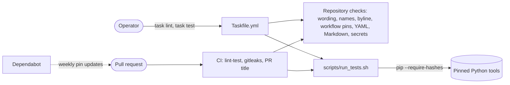

<!-- header:begin: the project page on luminare.tech drops this block, because the page has its own heading -->
<picture>
  <source media="(prefers-color-scheme: dark)" srcset="docs/brand/readme-header-dark.svg">
  <source media="(prefers-color-scheme: light)" srcset="docs/brand/readme-header-light.svg">
  
</picture>

<!-- byline:studio -->
*a [Luminare Development](https://luminare.tech/open-source/infra-edge-lab/) open-source project*
<!-- /byline:studio -->
<!-- byline:personal
*by ItsPaulAT · [project page](https://luminare.tech/open-source/infra-edge-lab/)*
/byline:personal -->
<!-- header:end -->

# infra-edge-lab

Infrastructure as code that rebuilds a small edge environment from nothing with one command, tested on every change.

[](https://github.com/luminare-dev/infra-edge-lab/actions/workflows/ci.yml)
[](https://github.com/luminare-dev/infra-edge-lab/releases)
[](LICENSE)
[](https://scorecard.dev/viewer/?uri=github.com/luminare-dev/infra-edge-lab)

## Why

Small server environments are often built by hand: a virtual machine here, a DNS record there, a
tunnel set up in a web console. Nobody can say whether they could be rebuilt after a loss, and
credentials end up in shell history. The goal of this project is one repository that describes
such an environment as code (OpenTofu for machines and DNS, Ansible for configuration, SOPS for
secrets) and checks every change before it lands. This version lays the foundation: the folder
layout, a toolchain pinned to exact versions and checksums, the rules for encrypted secrets, and
the checks and tests that run on every pull request.

## Quickstart

```bash
git clone https://github.com/luminare-dev/infra-edge-lab.git
cd infra-edge-lab
task test
task lint
```

`task test` needs go-task and Python 3.12 or 3.13; `task lint` also needs the tools listed in
[docs/toolchain.md](docs/toolchain.md). [docs/install.md](docs/install.md) has the details.

## How it works

`task lint` and `task test` run the same checks and tests as CI, so a change that passes them
locally also passes CI's lint-test and secret-scan jobs.



| Folder | Holds at this version |
|---|---|
| `tofu/modules/`, `tofu/envs/` | Nothing yet: reusable OpenTofu modules, and one root module with its own state per environment. |
| `ansible/` | Nothing yet: playbooks, inventories and the roles kept in this repository. |
| `secrets/` | The rules for SOPS-encrypted dotenv files and an example of their keys; no encrypted file. |
| `scripts/` | The repository checks from the template and `run_tests.sh`, the test command of CI. |
| `tests/` | Unit tests for the checks and for this repository's conventions. |
| `docs/` | Installation, configuration, toolchain, runbook, troubleshooting and the ADRs. |

## Design decisions

The decisions behind this project are recorded as short ADRs in [docs/adr/](docs/adr/):

- [ADR 0001: Record architecture decisions](docs/adr/0001-record-architecture-decisions.md)
- [ADR 0002: Pin every action and downloaded tool](docs/adr/0002-pin-actions-and-downloaded-tools.md)
- [ADR 0003: Secret scanning with the gitleaks binary](docs/adr/0003-secret-scanning-with-the-gitleaks-binary.md)
- [ADR 0004: Draft releases with checksums and provenance](docs/adr/0004-draft-releases-with-checksums-and-provenance.md)
- [ADR 0005: OpenTofu instead of Terraform](docs/adr/0005-opentofu-instead-of-terraform.md)
- [ADR 0006: SOPS and age for secrets, instead of CI-only secrets or Ansible Vault](docs/adr/0006-sops-and-age-for-secrets.md)
- [ADR 0007: Dependabot instead of Renovate](docs/adr/0007-dependabot-instead-of-renovate.md)
- [ADR 0008: go-task as the single entry point, instead of Make or loose scripts](docs/adr/0008-go-task-as-the-single-entry-point.md)

## Supported versions

| Component | Tested with | Supported |
|---|---|---|
| Python (tests and checks) | 3.12 (`python:3.12-slim`, as on the GitHub `ubuntu-24.04` runner), 3.13 (`python:3.13-slim`) | 3.12, 3.13 |
| ansible-core, ansible-lint, Molecule | not used yet: `scripts/run_tests.sh` installs them and checks the installed versions; no playbook, role or Molecule scenario exists at this version | the versions pinned in `requirements-test.in` |
| go-task | 3.54.0 | 3.54.0 |

Every other tool, with its checksum, is listed in [docs/toolchain.md](docs/toolchain.md).
Fixes go into the latest minor release only. See the
[security policy](https://github.com/luminare-dev/.github/blob/main/SECURITY.md) for reporting.

## Limitations

- This version holds the layout, the pinned toolchain and the checks only. It contains no
  OpenTofu module or environment and no Ansible playbook or role, so it cannot create or change
  any machine yet.
- No hypervisor, cloud account, DNS zone or tunnel was used for this version.
- This version ships no encrypted secrets file and no `.sops.yaml` with age recipients: each
  operator brings their own keys ([secrets/README.md](secrets/README.md)).
- The binary tools (OpenTofu, go-task, gitleaks and others) are pinned by version and sha256 but
  not watched by Dependabot; they are bumped by hand.
- Tested on Linux x86_64 only; the sha256 values in [docs/toolchain.md](docs/toolchain.md) are
  for the linux amd64 downloads.

## Results

| What | Value | How it was measured |
|---|---|---|
| Unit tests | 124 run, 0 failed, 4 skipped (three need gitleaks or markdownlint-cli2, which CI's lint-test job does not install; one applies to the template repository only) | `bash scripts/run_tests.sh` in `python:3.12-slim` and `python:3.13-slim` with git added, 2026-10-22 |
| Hash-pinned install of `requirements-test.txt` | 45 packages, `pip check` clean | `pip install --require-hashes --only-binary=:all:` in `python:3.12-slim` and `python:3.13-slim`, 2026-10-21 |
| Repository checks | 0 findings | `forbidden_words.py` (publish mode), `gitleaks git`, `yamllint --strict`, markdownlint-cli2 0.23.2, actionlint 1.7.12, zizmor 1.30.1, 2026-10-21 |

## Documentation and links

- [Installation](docs/install.md) · [Configuration](docs/configuration.md) ·
  [Toolchain](docs/toolchain.md) · [Upgrade](docs/upgrade.md) ·
  [Troubleshooting](docs/troubleshooting.md) · [Runbook](docs/runbook.md) · [ADRs](docs/adr/)
- Development: `task lint` and `task test` run the checks and tests of CI, and
  `pre-commit install` runs the quick ones before each commit (`.pre-commit-config.yaml`); the
  tools and versions are in [docs/toolchain.md](docs/toolchain.md).
- [Changelog](CHANGELOG.md) and [releases](https://github.com/luminare-dev/infra-edge-lab/releases)
  (each release has `SHA256SUMS` and a build provenance attestation)
- [Contributing](https://github.com/luminare-dev/.github/blob/main/CONTRIBUTING.md) ·
  [Code of conduct](https://github.com/luminare-dev/.github/blob/main/CODE_OF_CONDUCT.md) ·
  [Security](https://github.com/luminare-dev/.github/blob/main/SECURITY.md) ·
  [Support](https://github.com/luminare-dev/.github/blob/main/SUPPORT.md)
- Project page: <https://luminare.tech/open-source/infra-edge-lab/>

## Licence

[Apache-2.0](LICENSE). The licence covers the code only: the project name, logo, header images
and `docs/brand/` are not licensed (see [NOTICE](NOTICE)).

<!-- byline:studio -->
*a [Luminare Development](https://luminare.tech/open-source/infra-edge-lab/) open-source project*
<!-- /byline:studio -->
<!-- byline:personal
*by ItsPaulAT · [project page](https://luminare.tech/open-source/infra-edge-lab/)*
/byline:personal -->
