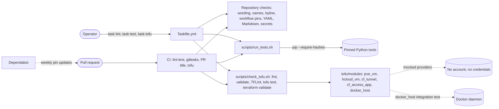

<!-- header:begin: the project page on luminare.tech drops this block, because the page has its own heading -->
<picture>
  <source media="(prefers-color-scheme: dark)" srcset="docs/brand/readme-header-dark.svg">
  <source media="(prefers-color-scheme: light)" srcset="docs/brand/readme-header-light.svg">
  
</picture>

<!-- byline:studio -->
*a [Luminare Development](https://luminare.tech/open-source/infra-edge-lab/) open-source project*
<!-- /byline:studio -->
<!-- byline:personal
*by ItsPaulAT · [project page](https://luminare.tech/open-source/infra-edge-lab/)*
/byline:personal -->
<!-- header:end -->

# infra-edge-lab

Infrastructure as code that rebuilds a small edge environment from nothing with one command, tested on every change.

[](https://github.com/luminare-dev/infra-edge-lab/actions/workflows/ci.yml)
[](https://github.com/luminare-dev/infra-edge-lab/releases)
[](LICENSE)
[](https://scorecard.dev/viewer/?uri=github.com/luminare-dev/infra-edge-lab)

## Why

Small server environments are often built by hand: a virtual machine here, a DNS record there, a
tunnel set up in a web console. Nobody can say whether they could be rebuilt after a loss, and
credentials end up in shell history. The goal of this project is one repository that describes
such an environment as code (OpenTofu for machines and DNS, Ansible for configuration, SOPS for
secrets) and checks every change before it lands. This version holds the foundation (the folder
layout, a toolchain pinned to exact versions and checksums, the rules for encrypted secrets and
the checks of every pull request) and the OpenTofu modules for virtual machines, cloud servers,
the tunnel, its DNS records, access rules and container hosts, each tested without any account.

## Quickstart

```bash
git clone https://github.com/luminare-dev/infra-edge-lab.git
cd infra-edge-lab
task test
task lint
task tofu
```

`task test` needs go-task and Python 3.12 or 3.13; `task lint` and `task tofu` also need the
tools listed in [docs/toolchain.md](docs/toolchain.md), and `task tofu` a Docker daemon that
allows privileged containers (or `task tofu STEPS='fmt validate tflint test compat'` without
Docker). [docs/install.md](docs/install.md) has the details.

## How it works

`task lint`, `task test` and `task tofu` run the same checks and tests as CI, so a change that
passes them locally also passes CI's lint-test, secret-scan and tofu jobs. The OpenTofu modules
are tested with mocked providers, so no test needs a hypervisor, a cloud account or a DNS zone;
the container-host module is also tested against a real Docker daemon.



| Folder | Holds at this version |
|---|---|
| `tofu/modules/` | Five OpenTofu modules, each with mocked tests and a lock file: `pve_vm` (Proxmox VE virtual machine), `hcloud_vm` (Hetzner Cloud server with firewall), `cf_tunnel` (tunnel, ingress rules and DNS records behind the shared-zone guard), `cf_access_app` (Access applications and service tokens) and `docker_host` (containers with systemd standing in for virtual machines). Each module has a README. |
| `tofu/envs/` | Nothing yet: one root module with its own state per environment. |
| `images/` | `systemd-host/Dockerfile`: the host image of `docker_host` (Debian 13 or Ubuntu 24.04, base images pinned by digest). |
| `ansible/` | Nothing yet: playbooks, inventories and the roles kept in this repository. |
| `secrets/` | The rules for SOPS-encrypted dotenv files and an example of their keys; no encrypted file. |
| `scripts/` | The repository checks from the template, `run_tests.sh` (the test command of CI), `check_tofu.sh` (the OpenTofu checks) and `install_tofu_tools.sh` (sha256-checked downloads of OpenTofu, TFLint and Terraform). |
| `tests/` | Unit tests for the checks and for this repository's conventions. |
| `docs/` | Installation, configuration, toolchain, runbook, troubleshooting and the ADRs. |

## Design decisions

The decisions behind this project are recorded as short ADRs in [docs/adr/](docs/adr/):

- [ADR 0001: Record architecture decisions](docs/adr/0001-record-architecture-decisions.md)
- [ADR 0002: Pin every action and downloaded tool](docs/adr/0002-pin-actions-and-downloaded-tools.md)
- [ADR 0003: Secret scanning with the gitleaks binary](docs/adr/0003-secret-scanning-with-the-gitleaks-binary.md)
- [ADR 0004: Draft releases with checksums and provenance](docs/adr/0004-draft-releases-with-checksums-and-provenance.md)
- [ADR 0005: OpenTofu instead of Terraform](docs/adr/0005-opentofu-instead-of-terraform.md)
- [ADR 0006: SOPS and age for secrets, instead of CI-only secrets or Ansible Vault](docs/adr/0006-sops-and-age-for-secrets.md)
- [ADR 0007: Dependabot instead of Renovate](docs/adr/0007-dependabot-instead-of-renovate.md)
- [ADR 0008: go-task as the single entry point, instead of Make or loose scripts](docs/adr/0008-go-task-as-the-single-entry-point.md)
- [ADR 0009: Guard rails for a shared DNS zone, instead of a separate zone or review alone](docs/adr/0009-guard-rails-for-a-shared-dns-zone.md)
- [ADR 0010: Systemd containers as a local substrate, instead of Molecule only or nested virtual machines](docs/adr/0010-systemd-containers-as-a-local-substrate.md)
- [ADR 0011: Remotely managed tunnel, and where its token goes](docs/adr/0011-remotely-managed-tunnel-and-its-token.md)
- [ADR 0012: Provider choices, version constraints and lock files](docs/adr/0012-provider-pins-and-lock-files.md)

## Supported versions

| Component | Tested with | Supported |
|---|---|---|
| Python (tests and checks) | 3.12 (`python:3.12-slim`, as on the GitHub `ubuntu-24.04` runner), 3.13 (`python:3.13-slim`) | 3.12, 3.13 |
| ansible-core, ansible-lint, Molecule | not used yet: `scripts/run_tests.sh` installs them and checks the installed versions; no playbook, role or Molecule scenario exists at this version | the versions pinned in `requirements-test.in` |
| go-task | 3.54.0 | 3.54.0 |
| OpenTofu | 1.13.1 | 1.13.1 (the modules declare `required_version = ">= 1.11.0"`; older versions are not tested) |
| Terraform | 1.16.6, `terraform validate` only | validation only; plans and applies use OpenTofu |
| OpenTofu providers | the versions locked in each module's `.terraform.lock.hcl` and the lowest version of each range ([docs/toolchain.md](docs/toolchain.md)) | the version ranges in each module's `versions.tf` |
| Docker Engine (`docker_host`) | 29.2.1 | 29.2.1; other versions that run privileged containers in the host cgroup namespace are untested |
| Host image (`docker_host`) | Debian 13, Ubuntu 24.04 | Debian 13, Ubuntu 24.04 |

Every other tool, with its checksum, is listed in [docs/toolchain.md](docs/toolchain.md).
Fixes go into the latest minor release only. See the
[security policy](https://github.com/luminare-dev/.github/blob/main/SECURITY.md) for reporting.

## Limitations

- This version holds OpenTofu modules but no environment that calls them, and no Ansible
  playbook or role, so the repository cannot create or configure an environment yet.
- No hypervisor, cloud account, DNS zone or tunnel was used for this version. `pve_vm`,
  `hcloud_vm`, `cf_tunnel` and `cf_access_app` were checked with `tofu validate`, TFLint,
  `terraform validate` and `tofu test` against mocked providers only; nothing was applied against
  Proxmox VE, Hetzner Cloud or Cloudflare. Whether the APIs accept every attribute as written,
  and the first boot of a cloud server, are not tested.
- The cloud-init user data of `hcloud_vm` was checked with `cloud-init schema` (cloud-init 25.1.4
  in a Debian 13 container), and its cloudflared install command was run in that container, with
  the right and with a wrong checksum; it never ran on a real server.
- `docker_host` was applied against a real Docker daemon (both host images); containers are not
  virtual machines, so kernel, firewall and boot checks stay for real machines.
- This version ships no encrypted secrets file and no `.sops.yaml` with age recipients: each
  operator brings their own keys ([secrets/README.md](secrets/README.md)).
- The binary tools (OpenTofu, go-task, gitleaks and others) are pinned by version and sha256 but
  not watched by Dependabot; they are bumped by hand.
- Tested on Linux x86_64 only; the sha256 values in [docs/toolchain.md](docs/toolchain.md) are
  for the linux amd64 downloads.

## Results

| What | Value | How it was measured |
|---|---|---|
| Unit tests | 143 run, 0 failed, 4 skipped (three need gitleaks or markdownlint-cli2, which CI's lint-test job does not install; one applies to the template repository only) | `bash scripts/run_tests.sh` in `python:3.12-slim` and `python:3.13-slim` with git added, 2026-10-22 |
| OpenTofu tests with mocked providers | 106 runs in 5 modules, 0 failed (`cf_tunnel` 38, `hcloud_vm` 30, `cf_access_app` 14, `docker_host` 12, `pve_vm` 12); the same with the lowest provider versions of each range (`cloudflare` 5.25.0, `hcloud` 1.69.0), `hcloud_vm` again after the change of its game port rules | `bash scripts/check_tofu.sh test` with OpenTofu 1.13.1 and the locked providers, 2026-10-22; the lowest versions in a copy with exact constraints and no lock file, 2026-10-21 and 2026-10-22 |
| `docker_host` against a real Docker daemon | 2 runs, 0 failed: 2 systemd hosts on Debian 13, then on Ubuntu 24.04, image builds included, everything destroyed afterwards; a second `tofu plan` after an apply reported no changes | `bash scripts/check_tofu.sh integration` on Docker Engine 29.2.1, and an apply plus plan of a scratch root module, 2026-10-21 |
| Validation and lint | 5 of 5 modules valid with `tofu validate` and with `terraform validate` (Terraform 1.16.6); TFLint 0 issues; Trivy 0.76.0 `trivy config`: 0 misconfigurations in the 5 modules and in `images/` once the one accepted finding is set aside (DS-0002, no `USER` in the host image, whose systemd must run as root; its reason is in `.trivyignore.yaml`) | `bash scripts/check_tofu.sh fmt validate tflint iac compat`, 2026-10-22 |
| Hash-pinned install of `requirements-test.txt` | 45 packages, `pip check` clean | `pip install --require-hashes --only-binary=:all:` in `python:3.12-slim` and `python:3.13-slim`, 2026-10-21 |
| Repository checks | 0 findings | `forbidden_words.py` (publish mode), `gitleaks git`, `yamllint --strict`, markdownlint-cli2 0.23.2, actionlint 1.7.12, zizmor 1.30.1, 2026-10-21 |

## Documentation and links

- [Installation](docs/install.md) · [Configuration](docs/configuration.md) ·
  [Toolchain](docs/toolchain.md) · [Upgrade](docs/upgrade.md) ·
  [Troubleshooting](docs/troubleshooting.md) · [Runbook](docs/runbook.md) · [ADRs](docs/adr/)
- Development: `task lint`, `task test` and `task tofu` run the checks and tests of CI, and
  `pre-commit install` runs the quick ones before each commit (`.pre-commit-config.yaml`); the
  tools and versions are in [docs/toolchain.md](docs/toolchain.md).
- [Changelog](CHANGELOG.md) and [releases](https://github.com/luminare-dev/infra-edge-lab/releases)
  (each release has `SHA256SUMS` and a build provenance attestation)
- [Contributing](https://github.com/luminare-dev/.github/blob/main/CONTRIBUTING.md) ·
  [Code of conduct](https://github.com/luminare-dev/.github/blob/main/CODE_OF_CONDUCT.md) ·
  [Security](https://github.com/luminare-dev/.github/blob/main/SECURITY.md) ·
  [Support](https://github.com/luminare-dev/.github/blob/main/SUPPORT.md)
- Project page: <https://luminare.tech/open-source/infra-edge-lab/>

## Licence

[Apache-2.0](LICENSE). The licence covers the code only: the project name, logo, header images
and `docs/brand/` are not licensed (see [NOTICE](NOTICE)).

<!-- byline:studio -->
*a [Luminare Development](https://luminare.tech/open-source/infra-edge-lab/) open-source project*
<!-- /byline:studio -->
<!-- byline:personal
*by ItsPaulAT · [project page](https://luminare.tech/open-source/infra-edge-lab/)*
/byline:personal -->
