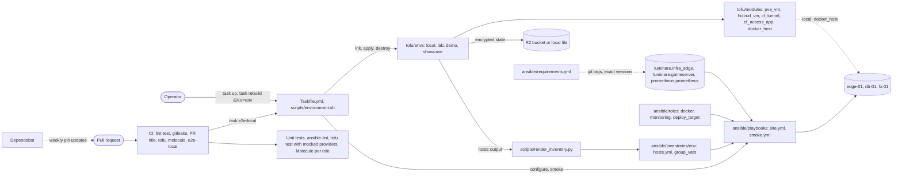

<!-- header:begin: the project page on luminare.tech drops this block, because the page has its own heading -->
<picture>
  <source media="(prefers-color-scheme: dark)" srcset="docs/brand/readme-header-dark.svg">
  <source media="(prefers-color-scheme: light)" srcset="docs/brand/readme-header-light.svg">
  
</picture>

<!-- byline:studio -->
*a [Luminare Development](https://luminare.tech/open-source/infra-edge-lab/) open-source project*
<!-- /byline:studio -->
<!-- byline:personal
*by ItsPaulAT · [project page](https://luminare.tech/open-source/infra-edge-lab/)*
/byline:personal -->
<!-- header:end -->

# infra-edge-lab

Infrastructure as code that rebuilds a small edge environment from nothing with one command, tested on every change.

[](https://github.com/luminare-dev/infra-edge-lab/actions/workflows/ci.yml)
[](https://github.com/luminare-dev/infra-edge-lab/releases)
[](LICENSE)
[](https://scorecard.dev/viewer/?uri=github.com/luminare-dev/infra-edge-lab)

## Why

Small server environments are often built by hand: a virtual machine here, a DNS record there, a
tunnel set up in a web console. Nobody can say whether they could be rebuilt after a loss, and
credentials end up in shell history. The goal of this project is one repository that describes
such an environment as code (OpenTofu for machines and DNS, Ansible for configuration, SOPS for
secrets) and checks every change before it lands. It holds the OpenTofu modules for virtual
machines, cloud servers, the tunnel, its DNS records, access rules and container hosts; four
environments built from them (`local`, `lab`, `demo`, `showcase`), each with encrypted state;
one playbook that configures every environment with the roles of the `luminare.infra_edge` and
`luminare.gameserver` collections (pinned to release tags) and the three roles that belong here
(`docker`, `monitoring`, `deploy_target`); and `task e2e:local`, which rebuilds the `local`
environment from nothing with one command on every pull request: three hosts with a web server,
a database, a game server (a stand-in build) and their monitoring, configured twice without a
change on the second run, smoke-tested, backed up and restore-tested, and thrown away again.

## Quickstart

```bash
git clone https://github.com/luminare-dev/infra-edge-lab.git
cd infra-edge-lab
task test
task e2e:local
```

`task test` needs go-task and Python 3.12 or 3.13. `task e2e:local` also needs OpenTofu, a
Docker daemon that allows privileged containers and the tagged collection repositories (or
collections from local checkouts, see [docs/troubleshooting.md](docs/troubleshooting.md));
it ends with a table of its steps and their times. `task lint` and `task tofu` run the
repository checks and the OpenTofu checks with the tools listed in
[docs/toolchain.md](docs/toolchain.md); `task molecule ROLE=docker` (or `monitoring`,
`deploy_target`) runs a role's Molecule scenario. [docs/install.md](docs/install.md) has the
details.

## How it works

`task lint`, `task test`, `task tofu`, `task molecule` and `task e2e:local` run the same checks
and tests as CI, so a change that passes them locally also passes CI's lint-test, secret-scan,
tofu, molecule and e2e-local jobs. The OpenTofu modules and environments are tested with mocked
providers, so no unit test needs a hypervisor, a cloud account or a DNS zone. Each environment
under `tofu/envs/` is one root module with its own state, encrypted by OpenTofu before it is
written (R2 for `lab`, `demo` and `showcase`, a local file for `local`); its tasks read its
credentials from its SOPS file when that file exists.

Every environment returns the same `hosts` output: host names with their groups (`edge`, `db`,
`fxserver`, `monitoring`, `docker_hosts`), addresses and how Ansible reaches them.
`scripts/render_inventory.py` turns it into an inventory, and `ansible/playbooks/site.yml`
configures the hosts from it in a fixed order: the base hardening with its firewall on every
host, Docker on the monitoring host, node_exporter everywhere, the tunnel connector (only with a
tunnel token) and nginx on the edge host, MariaDB on the database host, the game server with
its web admin panel and the upload-only deploy target on the game server host, Prometheus with
the game server observability pack on the monitoring host, and restic backups everywhere. Each
environment differs only in the values of `ansible/inventories/<env>/group_vars/`
([ADR 0021](docs/adr/0021-one-site-playbook-with-the-inventory-from-the-opentofu-outputs.md)).

`task e2e:local` proves the whole chain on every pull request without any account or secret
([ADR 0022](docs/adr/0022-an-end-to-end-run-of-the-local-environment-on-every-pull-request.md)):
it applies `local` (three systemd containers), writes the inventory, runs the playbook twice
(the second run must report `changed=0` on every host), plans again (no changes), smoke-tests
each host through `docker exec` (nginx answers 200 on loopback, MariaDB `SELECT 1`, the game
server's `/info.json`, every Prometheus target up, across the hosts' firewalls), backs each host
up and restores the newest snapshot (`playbooks/restore_test.yml`, also `task restore-test`) and
always destroys at the end. The game server is a stand-in build that answers the real server's HTTP
endpoints, the secrets are generated per run, and there is no tunnel. The roles in
`ansible/roles` are also tested one by one with Molecule on Debian 13 and Ubuntu 24.04, in
systemd containers built from the same image.



| Folder | Holds at this version |
|---|---|
| `tofu/modules/` | Five OpenTofu modules, each with mocked tests and a lock file: `pve_vm` (Proxmox VE virtual machine), `hcloud_vm` (Hetzner Cloud server with firewall), `cf_tunnel` (tunnel, ingress rules and DNS records behind the shared-zone guard), `cf_access_app` (Access applications and service tokens) and `docker_host` (containers with systemd standing in for virtual machines). Each module has a README. |
| `tofu/envs/` | Four environments, each a root module with its own encrypted state, lock file and guard tests ([tofu/envs/README.md](tofu/envs/README.md)): `local` (`edge-01`, `db-01` and `fx-01` as containers on the local Docker daemon, no account), `lab` (Proxmox VE), `demo` (one throw-away cloud server or container) and `showcase` (a protected long-lived server, skeleton only). |
| `images/` | `systemd-host/Dockerfile`: the host image of `docker_host` and of the Molecule scenarios (Debian 13 or Ubuntu 24.04, base images pinned by digest). |
| `ansible/` | `ansible.cfg`; `requirements.yml` (the luminare collections at git tags, `prometheus.prometheus` and the community collections at exact versions); `playbooks/site.yml` (every environment), `playbooks/smoke.yml` (the smoke test) and `playbooks/local_prepare.yml` (the stand-ins of the local environment); `inventories/local/group_vars/` (the values of the local environment; `hosts.yml` is generated); and the roles kept in this repository, each with a README and a Molecule scenario: [docker](ansible/roles/docker/README.md) (Docker Engine with published ports on loopback), [monitoring](ansible/roles/monitoring/README.md) (node_exporter, Uptime Kuma and its monitor checklist) and [deploy_target](ansible/roles/deploy_target/README.md) (an upload-only deploy key and a path unit). |
| `.config/molecule/` | The Molecule configuration that every role scenario shares (driver, both platforms, test sequence). |
| `secrets/` | The rules for SOPS-encrypted dotenv files and an example of their keys; no encrypted file. |
| `scripts/` | The repository checks from the template; `run_tests.sh` (the test command of CI); `check_tofu.sh` (the OpenTofu checks), `tofu_env.sh` (OpenTofu in one environment) and `install_tofu_tools.sh` (sha256-checked downloads of OpenTofu, TFLint and Terraform); `render_inventory.py` (the inventory from the OpenTofu outputs), `environment.sh` (up, inventory, configure, smoke, destroy and rebuild), `tunnel_token.py` (the tunnel token for one configure run) and `e2e_local.sh` (`task e2e:local`). |
| `tests/` | Unit tests for the checks, the scripts and this repository's conventions; `role_docs.py`, which generates the variable tables of the roles; and `fake-artifact/`, the stand-in game server build of the local environment ([README](tests/fake-artifact/README.md)). |
| `docs/` | Installation, configuration, toolchain, runbook, troubleshooting and the ADRs. |

## Design decisions

The decisions behind this project are recorded as short ADRs in [docs/adr/](docs/adr/):

- [ADR 0001: Record architecture decisions](docs/adr/0001-record-architecture-decisions.md)
- [ADR 0002: Pin every action and downloaded tool](docs/adr/0002-pin-actions-and-downloaded-tools.md)
- [ADR 0003: Secret scanning with the gitleaks binary](docs/adr/0003-secret-scanning-with-the-gitleaks-binary.md)
- [ADR 0004: Draft releases with checksums and provenance](docs/adr/0004-draft-releases-with-checksums-and-provenance.md)
- [ADR 0005: OpenTofu instead of Terraform](docs/adr/0005-opentofu-instead-of-terraform.md)
- [ADR 0006: SOPS and age for secrets, instead of CI-only secrets or Ansible Vault](docs/adr/0006-sops-and-age-for-secrets.md)
- [ADR 0007: Dependabot instead of Renovate](docs/adr/0007-dependabot-instead-of-renovate.md)
- [ADR 0008: go-task as the single entry point, instead of Make or loose scripts](docs/adr/0008-go-task-as-the-single-entry-point.md)
- [ADR 0009: Guard rails for a shared DNS zone, instead of a separate zone or review alone](docs/adr/0009-guard-rails-for-a-shared-dns-zone.md)
- [ADR 0010: Systemd containers as a local substrate, instead of Molecule only or nested virtual machines](docs/adr/0010-systemd-containers-as-a-local-substrate.md)
- [ADR 0011: Remotely managed tunnel, and where its token goes](docs/adr/0011-remotely-managed-tunnel-and-its-token.md)
- [ADR 0012: Provider choices, version constraints and lock files](docs/adr/0012-provider-pins-and-lock-files.md)
- [ADR 0013: Encrypted state in R2 with a lock file, instead of local files or a managed backend](docs/adr/0013-encrypted-state-in-r2-with-a-lock-file.md)
- [ADR 0014: One root module per environment, instead of workspaces](docs/adr/0014-one-root-module-per-environment.md)
- [ADR 0015: Molecule on the shared systemd host image, instead of prebuilt images or virtual machines](docs/adr/0015-molecule-on-the-shared-systemd-host-image.md)
- [ADR 0016: Collections from git tags, and one pinned bundle for the tests, instead of Ansible Galaxy](docs/adr/0016-collections-from-git-tags-and-one-pinned-bundle.md)
- [ADR 0017: node_exporter from the release archive with a pinned checksum, instead of a shared role or the distribution package](docs/adr/0017-node-exporter-from-the-release-archive.md)
- [ADR 0018: Uptime Kuma monitors as a checklist, instead of an unofficial API client](docs/adr/0018-uptime-kuma-monitors-as-a-checklist.md)
- [ADR 0019: Docker with ports on loopback, and a firewall reload that restarts Docker](docs/adr/0019-docker-ports-on-loopback-and-a-firewall-that-restarts-docker.md)
- [ADR 0020: An upload-only deploy key and a path unit, instead of a deploy command over SSH or a pull model](docs/adr/0020-upload-only-deploy-key-and-a-path-unit.md)
- [ADR 0021: One site playbook for every environment, with the inventory from the OpenTofu outputs, instead of a playbook per environment or a dynamic inventory](docs/adr/0021-one-site-playbook-with-the-inventory-from-the-opentofu-outputs.md)
- [ADR 0022: An end-to-end run of the local environment on every pull request, instead of a scheduled cloud run or one Molecule scenario for all hosts](docs/adr/0022-an-end-to-end-run-of-the-local-environment-on-every-pull-request.md)

## Supported versions

| Component | Tested with | Supported |
|---|---|---|
| Python (tests and checks) | 3.12 (`python:3.12-slim`, as on the GitHub `ubuntu-24.04` runner), 3.13 (`python:3.13-slim`) | 3.12, 3.13 |
| ansible-core, ansible (collections), ansible-lint, Molecule | the versions pinned in `requirements-test.in`: `scripts/run_tests.sh` checks the installed versions and runs ansible-lint; the Molecule jobs use the same file | the versions pinned in `requirements-test.in` |
| Managed hosts of the roles in `ansible/roles` | Debian 13, Ubuntu 24.04 (x86_64, systemd containers in Molecule) | Debian 13, Ubuntu 24.04 on x86_64 or arm64 (the roles check this; arm64 is not tested) |
| Managed hosts of `ansible/playbooks/site.yml` | Debian 13 (x86_64, the systemd containers of `task e2e:local`) | Debian 13 and Ubuntu 24.04 on x86_64, the platforms of every role it runs; Ubuntu 24.04 is tested role by role only |
| `luminare.infra_edge`, `luminare.gameserver` | built from the development branches of both repositories on 2026-10-22, before their tags existed | the tags pinned in `ansible/requirements.yml` |
| `prometheus.prometheus`, `devsec.hardening` | 0.30.2, 11.0.0 | the versions pinned in `ansible/requirements.yml` |
| Prometheus (`local` environment) | 3.15.0 | the version and sha256 pinned in `ansible/inventories/local/group_vars/monitoring.yml` |
| node_exporter (`monitoring`) | 1.12.1 | 1.12.1, the pinned version and checksums |
| Uptime Kuma (`monitoring`) | 2.5.6, `slim` image | the image pinned by digest |
| Docker Engine installed by the `docker` role | 29.9.2, the newest release of Docker's `stable` channel on 2026-10-21 (Debian 13 and Ubuntu 24.04) | the current release of Docker's `stable` channel |
| go-task | 3.54.0 | 3.54.0 |
| OpenTofu | 1.13.1 | 1.13.1 (modules and environments declare `required_version = ">= 1.11.0"`; older versions are not tested) |
| Terraform | 1.16.6, `terraform validate` only | validation only; plans and applies use OpenTofu |
| OpenTofu providers | the versions locked in each `.terraform.lock.hcl` and the lowest version of each range ([docs/toolchain.md](docs/toolchain.md)) | the version ranges in each `versions.tf` |
| Docker Engine (`docker_host`, `local` environment, Molecule) | 29.2.1 | 29.2.1; other versions that run privileged containers in the host cgroup namespace are untested |
| Host image (`docker_host`, Molecule) | Debian 13, Ubuntu 24.04 | Debian 13, Ubuntu 24.04 |

Every other tool, with its checksum, is listed in [docs/toolchain.md](docs/toolchain.md).
Fixes go into the latest minor release only. See the
[security policy](https://github.com/luminare-dev/.github/blob/main/SECURITY.md) for reporting.

## Limitations

- Only the `local` environment has its inventory values (`ansible/inventories/local/group_vars/`)
  at this version. `lab`, `demo` and `showcase` need theirs, with their secrets in `*.sops.yaml`
  files, before `task configure` can run there; `demo` and `showcase` also need SSH through the
  tunnel (`cloudflared access ssh`), which nothing sets up yet. `task up` does not export the
  zone's DNS records before an apply; the [runbook](docs/runbook.md) lists it as a manual step.
- `ansible/requirements.yml` pins `luminare.infra_edge` and `luminare.gameserver` to the tag
  `v0.2.0` of their repositories. The end-to-end runs of this version used collections built
  from both repositories' development branches before those tags existed; the CI workflow
  `e2e-local` installs the tags and fails until both repositories are public and tagged.
- `task e2e:local` runs the playbook on Debian 13 containers only; Ubuntu 24.04 is tested role by
  role with Molecule. Containers are not virtual machines: the kernel, boot order and real network
  interfaces are the runner's. The base firewall is loaded in each container's own network
  namespace, with one addition that a real host never gets: a drop-in that keeps Docker's DNS
  server reachable after the firewall's `flush ruleset`
  ([ADR 0022](docs/adr/0022-an-end-to-end-run-of-the-local-environment-on-every-pull-request.md)).
- The game server of `local` is a stand-in build (`tests/fake-artifact/`) that answers the real
  server's HTTP endpoints; the real server build, a real license key and a player connection are
  not tested here. `local` has no tunnel, so the tunnel connector role, the tunnel token fetch
  (`scripts/tunnel_token.py`, tested against a stand-in for the API only) and the Access rules
  never run in it, and its backups go to a folder on each host instead of a bucket.
- The roles were also tested in privileged systemd containers only (Molecule, Debian 13 and
  Ubuntu 24.04 on x86_64), not on a virtual machine or an arm64 host. Not tested: an alert from
  Uptime Kuma after an outage (monitors and notifications are created by hand,
  [ADR 0018](docs/adr/0018-uptime-kuma-monitors-as-a-checklist.md)), Docker's forward rules on a
  host with real network interfaces, the boot order of Docker after `nftables.service` (no host is
  rebooted), and uploads from a CI runner through a tunnel.
- Prometheus on the monitoring host evaluates the observability pack's rules and lists the
  firing alerts; nothing sends them (no Alertmanager) and no Grafana shows the pack's dashboard.
  No mysqld_exporter is deployed yet, so the pack's database alerts (`MariaDBDown`,
  `MariaDBSlowQueries`) cannot fire; the host and build alerts read node_exporter, whose target on
  a game server host carries the pack's `server` label.
- `deploy_target` installs the deploy script of a release pipeline; this repository ships none.
  Molecule and the `local` environment use a test script that only checks the checksum and
  deletes the upload, so unpacking a release and the handling of a wrong checksum are not tested
  here.
- No hypervisor, cloud account, DNS zone, tunnel or R2 bucket was used for this version. The
  modules and the `lab`, `demo` and `showcase` environments were checked with `tofu validate`,
  TFLint, `terraform validate` and `tofu test` against mocked providers, and the three
  environments with `tofu plan` against the real providers in a network namespace without any
  network access (placeholder credentials, local state); nothing was applied against Proxmox VE,
  Hetzner Cloud or Cloudflare. Whether the APIs accept every attribute as written, and the first
  boot of a cloud server, are not tested.
- The R2 state backend was checked offline only: `tofu init` accepted its settings and the
  endpoint from `AWS_ENDPOINT_URL_S3` and stopped at the first network request. Whether R2
  honours the conditional write behind `use_lockfile` (the lock test of
  [ADR 0013](docs/adr/0013-encrypted-state-in-r2-with-a-lock-file.md)), a backup of the state
  after each apply, and CI plans with read-only tokens are open.
- The passphrase change in the [runbook](docs/runbook.md) was tested on a local state file, not
  on R2.
- `showcase` is a skeleton: it is planned in tests only and is meant to be applied together with
  the server it will host.
- The cloud-init user data of `hcloud_vm` was checked with `cloud-init schema` (cloud-init 25.1.4
  in a Debian 13 container), and its cloudflared install command was run in that container, with
  the right and with a wrong checksum; it never ran on a real server.
- This version ships no encrypted secrets file and no `.sops.yaml` with age recipients: each
  operator brings their own keys ([secrets/README.md](secrets/README.md)).
- The binary tools (OpenTofu, go-task, gitleaks and others) are pinned by version and sha256 but
  not watched by Dependabot; they are bumped by hand.
- Tested on Linux x86_64 only; the sha256 values in [docs/toolchain.md](docs/toolchain.md) are
  for the linux amd64 downloads.

## Results

| What | Value | How it was measured |
|---|---|---|
| `task e2e:local`: the `local` environment rebuilt from nothing | 2 runs, both passed, 768 s and 767 s in all. Per step (first run / second run): `tofu init` 1.0 / 1.0 s; `tofu apply` 12.3 / 12.9 s (5 resources: `edge-01`, `db-01` and `fx-01` on Debian 13, their network and the host image from Docker's build cache); inventory 1.9 / 1.9 s; first playbook run (`local_prepare.yml` and `site.yml`) 463.6 / 461.6 s; second run 267.1 / 268.2 s with `changed=0` on all three hosts (136, 240 and 202 tasks ok); second `tofu plan` 5.2 / 5.2 s with no changes; smoke test 4.2 / 4.5 s (nginx 200 on loopback, MariaDB `SELECT 1`, `/info.json` with build 35245, all 10 Prometheus targets up: Prometheus, node_exporter of the three hosts across their firewalls, and six targets of the observability jobs); destroy 10.3 / 10.1 s, nothing left on the daemon. These two runs predate the restore test, now the last step before the destroy; it was not run at this commit | `task e2e:local` with the luminare collections built from the development branches of both repositories and installed through `ANSIBLE_COLLECTIONS_PATH` (the collection step then only lists them), `devsec.hardening` 11.0.0 and `prometheus.prometheus` 0.30.2 from Ansible Galaxy; OpenTofu 1.13.1, the tools of `requirements-test.txt`, Docker Engine 29.2.1, one run at a time, 2026-10-22 |
| Unit tests | 268 run, 0 failed, 4 skipped (three need gitleaks or markdownlint-cli2, which CI's lint-test job does not install; one applies to the template repository only) | `bash scripts/run_tests.sh` in `python:3.12-slim` and `python:3.13-slim` with git added, 2026-10-22 |
| ansible-lint | production profile passed: 0 failures, 0 warnings in 91 files (the three roles and their Molecule playbooks, the playbooks in `ansible/playbooks`, the `group_vars` of `local` and the other YAML files of the repository; the collections' roles mocked) | the last step of `bash scripts/run_tests.sh` (offline, collections from the `ansible` package only), ansible-lint 26.10.1, in the same two containers, 2026-10-22 |
| Molecule scenarios of the roles | the last run of each of the 3 roles on Debian 13 and on Ubuntu 24.04 (6 runs), 0 failed: every step passed, the idempotence step reported `changed=0` in each run; run time per role and platform (Debian 13 / Ubuntu 24.04): `docker` 216 s / 250 s (2026-10-22, with Docker's start limit raised and six firewall restarts within a minute checked), `monitoring` 263 s / 321 s, `deploy_target` 214 s / 207 s (2026-10-21), image builds from Docker's cache, package downloads and the Uptime Kuma image pull included | `molecule test --platform-name lab-<role>-<platform>` (what each CI matrix job runs) with the tools of `requirements-test.txt` and only the collections of its `ansible` package, at most two runs at a time, Docker Engine 29.2.1 |
| OpenTofu tests with mocked providers | 145 runs in 5 modules and 4 environments, 0 failed (`cf_tunnel` 38, `hcloud_vm` 30, `docker_host` 15, `cf_access_app` 14, `pve_vm` 12; `lab` 12, `demo` 11, `showcase` 10, `local` 3), 2026-10-22; with the lowest provider versions of each range (`cloudflare` 5.25.0, `hcloud` 1.69.0) the 139 runs before the Docker storage tests of `docker_host` passed on 2026-10-21, and the 51 runs of `hcloud_vm`, `demo` and `showcase` after the change of the game port rules on 2026-10-22 | `bash scripts/check_tofu.sh test` with OpenTofu 1.13.1 and the locked providers; the lowest versions in a copy with exact constraints and no lock file |
| State of the `local` environment | the state file holds no host name in clear text and a wrong passphrase cannot read it; the passphrase change of the [runbook](docs/runbook.md) re-encrypted the state with a new passphrase and the old one could no longer read it | `task init ENV=local`, `tofu apply`, the runbook procedure, `tofu destroy` with a random `TF_VAR_state_passphrase`; OpenTofu 1.13.1, 2026-10-21 |
| Environments planned with the real providers, without any network | `lab` 17, `demo` 13 (`substrate = "hcloud"`) and 13 (`substrate = "docker"`, without `HCLOUD_TOKEN`), `showcase` 15 resources to add, no error; the R2 backend took its endpoint from `AWS_ENDPOINT_URL_S3` (without it, `tofu init` addressed AWS) | `task init ENV=<env> BACKEND=local`, then `scripts/tofu_env.sh plan <env>` (what `task plan` runs) inside `unshare -n` (loopback only) with placeholder credentials, documentation values and a `DOCKER_HOST` that cannot be reached; `tofu init` of `lab` with the remote backend in the same namespace; OpenTofu 1.13.1, 2026-10-21 |
| `docker_host` against a real Docker daemon | 2 runs, 0 failed: 2 systemd hosts on Debian 13, then on Ubuntu 24.04, image builds included, the monitoring host with its Docker storage tmpfs, everything destroyed afterwards | `bash scripts/check_tofu.sh integration` on Docker Engine 29.2.1, 2026-10-22 |
| Validation and lint | 5 modules and 4 environments valid with `tofu validate` and with `terraform validate` (Terraform 1.16.6); TFLint 0 issues; Trivy 0.76.0 `trivy config`: 0 misconfigurations in `tofu/` (the 4 environments with the modules they call) and in `images/` once the one accepted finding is set aside (DS-0002, no `USER` in the host image, whose systemd must run as root; its reason is in `.trivyignore.yaml`) | `bash scripts/check_tofu.sh fmt validate tflint iac compat`, 2026-10-22 |
| Hash-pinned install of `requirements-test.txt` | 46 packages, `pip check` clean | `pip install --require-hashes --only-binary=:all:` in `python:3.12-slim` and `python:3.13-slim`, 2026-10-21 (the file is unchanged since) |
| Repository checks | 0 findings | `forbidden_words.py` (publish mode), `gitleaks git`, `yamllint --strict`, markdownlint-cli2 0.23.2, actionlint 1.7.12 (with shellcheck), zizmor 1.30.1, 2026-10-22 |

## Documentation and links

- [Installation](docs/install.md) · [Configuration](docs/configuration.md) ·
  [Toolchain](docs/toolchain.md) · [Upgrade](docs/upgrade.md) ·
  [Troubleshooting](docs/troubleshooting.md) · [Runbook](docs/runbook.md) · [ADRs](docs/adr/)
- Development: `task lint`, `task test`, `task tofu` and `task molecule` run the checks and tests
  of CI, and `pre-commit install` runs the quick ones before each commit
  (`.pre-commit-config.yaml`); the tools and versions are in [docs/toolchain.md](docs/toolchain.md).
  Each role in `ansible/roles` has its own README.
- [Changelog](CHANGELOG.md) and [releases](https://github.com/luminare-dev/infra-edge-lab/releases)
  (each release has `SHA256SUMS` and a build provenance attestation)
- [Contributing](https://github.com/luminare-dev/.github/blob/main/CONTRIBUTING.md) ·
  [Code of conduct](https://github.com/luminare-dev/.github/blob/main/CODE_OF_CONDUCT.md) ·
  [Security](https://github.com/luminare-dev/.github/blob/main/SECURITY.md) ·
  [Support](https://github.com/luminare-dev/.github/blob/main/SUPPORT.md)
- Project page: <https://luminare.tech/open-source/infra-edge-lab/>

## Not affiliated

Not affiliated with or endorsed by Cfx.re, Rockstar Games or Take-Two.

## Licence

[Apache-2.0](LICENSE). The licence covers the code only: the project name, logo, header images
and `docs/brand/` are not licensed (see [NOTICE](NOTICE)).

<!-- byline:studio -->
*a [Luminare Development](https://luminare.tech/open-source/infra-edge-lab/) open-source project*
<!-- /byline:studio -->
<!-- byline:personal
*by ItsPaulAT · [project page](https://luminare.tech/open-source/infra-edge-lab/)*
/byline:personal -->
