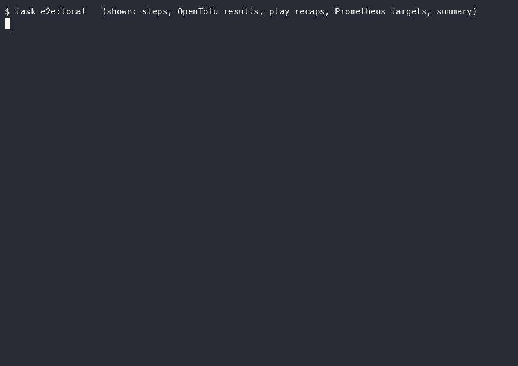
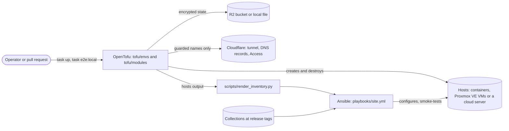

<!-- header:begin: the project page on luminare.tech drops this block, because the page has its own heading -->
<picture>
  <source media="(prefers-color-scheme: dark)" srcset="docs/brand/readme-header-dark.svg">
  <source media="(prefers-color-scheme: light)" srcset="docs/brand/readme-header-light.svg">
  
</picture>

<!-- byline:studio -->
*a [Luminare Development](https://luminare.tech/open-source/infra-edge-lab/) open-source project*
<!-- /byline:studio -->
<!-- byline:personal
*by ItsPaulAT · [project page](https://luminare.tech/open-source/infra-edge-lab/)*
/byline:personal -->
<!-- header:end -->

# infra-edge-lab

Infrastructure as code that rebuilds a small edge environment from nothing with one command, tested on every change.

[](https://github.com/luminare-dev/infra-edge-lab/actions/workflows/ci.yml)
[](https://github.com/luminare-dev/infra-edge-lab/releases)
[](LICENSE)
[](https://scorecard.dev/viewer/?uri=github.com/luminare-dev/infra-edge-lab)



## Why

Small server environments are often built by hand: a virtual machine here, a DNS record there, a
tunnel set up in a web console, and nobody can say whether they could be rebuilt after a loss.
infra-edge-lab describes such an environment as code (OpenTofu for the machines, the tunnel and
its DNS records, Ansible for the configuration, SOPS for the credentials) and proves on every pull
request that it rebuilds from nothing with one command: three hosts are created, configured twice
without a change on the second run, smoke-tested, backed up and restored, and thrown away. It
never manages an existing production server: every environment creates and destroys only its own
hosts, and it may write only DNS names with its own prefix.

**Kurzfassung auf Deutsch:** infra-edge-lab beschreibt eine kleine Server-Umgebung (Hosts, Tunnel,
DNS-Einträge, Konfiguration und Zugangsdaten) vollständig als Code mit OpenTofu, Ansible und SOPS.
Jeder Pull Request baut eine Testumgebung aus drei Containern mit einem einzigen Befehl von Grund
auf neu, prüft, dass ein zweiter Lauf nichts ändert, testet die Dienste und die Wiederherstellung
der Backups und baut sie wieder ab.

## Quickstart

```bash
git clone https://github.com/luminare-dev/infra-edge-lab.git
cd infra-edge-lab
task test
task e2e:local
```

This needs go-task, Python 3.12 or 3.13 with `venv`, git, OpenTofu and a Docker daemon that
allows privileged containers, but no account and no secret ([docs/install.md](docs/install.md)).
`task test` runs the unit tests and ansible-lint. `task e2e:local` creates `edge-01`, `db-01` and
`fx-01` as systemd containers, installs the pinned collections from their GitHub release tags,
configures the hosts twice (the second run must change nothing), plans again (no changes),
smoke-tests them, backs each host up and restores the backup, destroys them and ends with a table
of its steps and their times.

## How it works



Each environment under `tofu/envs/` is one root module with its own encrypted state, built from
five modules: a Proxmox VE virtual machine, a cloud server with its firewall, the tunnel with its
ingress rules and DNS records, the Access applications, and systemd containers that stand in for
machines. Every environment returns the same `hosts` output, so one playbook configures them all:
`ansible/playbooks/site.yml` runs the roles of the `luminare.infra_edge` and
`luminare.gameserver` collections and the three roles kept here (`docker`, `monitoring`,
`deploy_target`): base hardening and the firewall on every host, the tunnel connector and nginx
on the edge host, MariaDB, the game server with its admin panel and an upload-only deploy target,
Prometheus with the observability pack on the monitoring host, and node_exporter and restic
backups on every host.
Credentials live in SOPS files and reach a command only through its environment; the tunnel
token is fetched for one playbook run and never written to the workstation.

| Environment | Hosts | At this version |
|---|---|---|
| `local` | `edge-01`, `db-01`, `fx-01` as systemd containers on the local Docker daemon | rebuilt from nothing by CI on every pull request (`e2e-local`) |
| `lab` | Proxmox VE virtual machines behind a tunnel and Access | validated, linted and tested with mocked providers; never applied |
| `demo` | one throw-away cloud server, or a container for the tunnel test | validated and tested with mocked providers; never applied with a tunnel; its host configuration ran on a container |
| `showcase` | one protected long-lived cloud server (skeleton) | validated and planned with mocked providers and offline; meant to be applied together with the server it will host |

CI runs the same checks as `task lint`, `task test`, `task tofu`, `task molecule` and
`task e2e:local`. The workflows for the cloud environments (`plan`, `apply`, `drift`,
`e2e-tunnel`) stay off until the owner sets `CLOUD_ENVS_ENABLED`; every write into the shared
DNS zone is checked by name rules, tests and a preflight against the live zone first.
[docs/architecture.md](docs/architecture.md) describes the parts, the network, the secrets and
the repository layout.

## Design decisions

The decisions behind this project are recorded as short ADRs in [docs/adr/](docs/adr/). The main
decisions of the design:

- [ADR 0005: OpenTofu instead of Terraform](docs/adr/0005-opentofu-instead-of-terraform.md)
- [ADR 0012: bpg/proxmox instead of the Telmate provider, version constraints and lock files](docs/adr/0012-provider-pins-and-lock-files.md)
- [ADR 0011: A remotely managed tunnel, with its token never in an output](docs/adr/0011-remotely-managed-tunnel-and-its-token.md)
- [ADR 0006: SOPS and age for secrets, instead of CI-only secrets or Ansible Vault](docs/adr/0006-sops-and-age-for-secrets.md)
- [ADR 0013: Encrypted state in R2 with a lock file, instead of local files or a managed backend](docs/adr/0013-encrypted-state-in-r2-with-a-lock-file.md)
- [ADR 0025: Proxmox VE API tokens with least privilege, instead of the root account](docs/adr/0025-proxmox-ve-api-tokens-with-least-privilege.md)
- [ADR 0026: TLS between the tunnel connector and its origins](docs/adr/0026-tls-between-the-tunnel-connector-and-its-origins.md)
- [ADR 0027: restic for the backups of every host, instead of hypervisor snapshots or BorgBackup](docs/adr/0027-restic-for-the-backups-of-every-host.md)
- [ADR 0014: One root module per environment (local, lab, demo, showcase), instead of workspaces](docs/adr/0014-one-root-module-per-environment.md)
- [ADR 0010: Systemd containers as a local substrate, instead of Molecule only or nested virtual machines](docs/adr/0010-systemd-containers-as-a-local-substrate.md)
- [ADR 0016: Collections from git tags, and one pinned bundle for the tests, instead of Ansible Galaxy](docs/adr/0016-collections-from-git-tags-and-one-pinned-bundle.md)
- [ADR 0028: The game server runs as the user `fxserver`](docs/adr/0028-the-game-server-user-fxserver.md)

How the repository is checked, and the decisions of the roles and workflows:

- [ADR 0001: Record architecture decisions](docs/adr/0001-record-architecture-decisions.md)
- [ADR 0002: Pin every action and downloaded tool](docs/adr/0002-pin-actions-and-downloaded-tools.md)
- [ADR 0003: Secret scanning with the gitleaks binary](docs/adr/0003-secret-scanning-with-the-gitleaks-binary.md)
- [ADR 0004: Draft releases with checksums and provenance](docs/adr/0004-draft-releases-with-checksums-and-provenance.md)
- [ADR 0007: Dependabot instead of Renovate](docs/adr/0007-dependabot-instead-of-renovate.md)
- [ADR 0008: go-task as the single entry point, instead of Make or loose scripts](docs/adr/0008-go-task-as-the-single-entry-point.md)
- [ADR 0009: Guard rails for a shared DNS zone, instead of a separate zone or review alone](docs/adr/0009-guard-rails-for-a-shared-dns-zone.md)
- [ADR 0015: Molecule on the shared systemd host image, instead of prebuilt images or virtual machines](docs/adr/0015-molecule-on-the-shared-systemd-host-image.md)
- [ADR 0017: node_exporter from the release archive with a pinned checksum, instead of a shared role or the distribution package](docs/adr/0017-node-exporter-from-the-release-archive.md)
- [ADR 0018: Uptime Kuma monitors as a checklist, instead of an unofficial API client](docs/adr/0018-uptime-kuma-monitors-as-a-checklist.md)
- [ADR 0019: Docker with ports on loopback, and a firewall reload that restarts Docker](docs/adr/0019-docker-ports-on-loopback-and-a-firewall-that-restarts-docker.md)
- [ADR 0020: An upload-only deploy key and a path unit, instead of a deploy command over SSH or a pull model](docs/adr/0020-upload-only-deploy-key-and-a-path-unit.md)
- [ADR 0021: One site playbook for every environment, with the inventory from the OpenTofu outputs, instead of a playbook per environment or a dynamic inventory](docs/adr/0021-one-site-playbook-with-the-inventory-from-the-opentofu-outputs.md)
- [ADR 0022: An end-to-end run of the local environment on every pull request, instead of a scheduled cloud run or one Molecule scenario for all hosts](docs/adr/0022-an-end-to-end-run-of-the-local-environment-on-every-pull-request.md)
- [ADR 0023: Gated cloud workflows with read-only plans and reviewed applies, instead of no cloud CI or repository secrets on every pull request](docs/adr/0023-gated-cloud-workflows-with-read-only-plans-and-reviewed-applies.md)
- [ADR 0024: A tunnel test guarded by a zone preflight, a comparison and a sweeper, instead of a cloud server or mocks only](docs/adr/0024-a-tunnel-test-guarded-by-a-zone-preflight-a-comparison-and-a-sweeper.md)

## Supported versions

| Component | Tested with | Supported |
|---|---|---|
| Python (tests and checks) | 3.12 (`python:3.12-slim`, as on the GitHub `ubuntu-24.04` runner), 3.13 (`python:3.13-slim`) | 3.12, 3.13 |
| ansible-core, ansible (collections), ansible-lint, Molecule | the versions pinned in `requirements-test.in`: `scripts/run_tests.sh` checks the installed versions and runs ansible-lint; the Molecule jobs use the same file | the versions pinned in `requirements-test.in` |
| Managed hosts of the roles in `ansible/roles` | Debian 13, Ubuntu 24.04 (x86_64, systemd containers in Molecule) | Debian 13, Ubuntu 24.04 on x86_64 or arm64 (the roles check this; arm64 is not tested) |
| Managed hosts of `ansible/playbooks/site.yml` | Debian 13 (x86_64, the systemd containers of `task e2e:local`) | Debian 13 and Ubuntu 24.04 on x86_64, the platforms of every role it runs; Ubuntu 24.04 is tested role by role only |
| `luminare.infra_edge` | `v0.2.1`, installed from its public GitHub repository by `task e2e:local` on 2026-10-22 | the tag pinned in `ansible/requirements.yml` |
| `luminare.gameserver` | `v0.2.0`, installed from its public GitHub repository by `task e2e:local` on 2026-10-22 | the tag pinned in `ansible/requirements.yml` |
| `prometheus.prometheus`, `devsec.hardening` | 0.30.2, 11.0.0 | the versions pinned in `ansible/requirements.yml` |
| Prometheus (`local` environment) | 3.15.0 | the version and sha256 pinned in `ansible/inventories/local/group_vars/monitoring.yml` |
| node_exporter (`monitoring`) | 1.12.1 | 1.12.1, the pinned version and checksums |
| Uptime Kuma (`monitoring`) | 2.5.6, `slim` image | the image pinned by digest |
| Docker Engine installed by the `docker` role | 29.9.2, the newest release of Docker's `stable` channel on 2026-10-21 (Debian 13 and Ubuntu 24.04) | the current release of Docker's `stable` channel |
| go-task | 3.54.0 | 3.54.0 |
| cloudflared on the control node (`task e2e:tunnel`) | 2026.10.2: `--version` and the flags of `access ssh --help` only | 2026.10.2, the pinned version and sha256 |
| OpenTofu | 1.13.1 | 1.13.1 (modules and environments declare `required_version = ">= 1.11.0"`; older versions are not tested) |
| Terraform | 1.16.6, `terraform validate` only | validation only; plans and applies use OpenTofu |
| OpenTofu providers | the versions locked in each `.terraform.lock.hcl` and the lowest version of each range ([docs/toolchain.md](docs/toolchain.md)) | the version ranges in each `versions.tf` |
| Docker Engine (`docker_host`, `local` environment, Molecule) | 29.2.1 | 29.2.1; other versions that run privileged containers in the host cgroup namespace are untested |
| Host image (`docker_host`, Molecule) | Debian 13, Ubuntu 24.04 | Debian 13, Ubuntu 24.04 |

Every other tool, with its checksum, is listed in [docs/toolchain.md](docs/toolchain.md).
Fixes go into the latest minor release only. See the
[security policy](https://github.com/luminare-dev/.github/blob/main/SECURITY.md) for reporting.

## Limitations

- **Proxmox VE and Hetzner Cloud: validated and mock-tested only.** `lab`, `demo` with
  `substrate = "hcloud"` and `showcase` were checked with `tofu validate`, TFLint,
  `terraform validate`, `tofu test` against mocked providers and a plan against the real
  providers without network access; nothing was applied to a hypervisor or a cloud account.
  Whether the APIs accept every attribute, the first boot of a cloud server (its cloud-init data
  passed `cloud-init schema` only) and the Proxmox VE privileges of
  [ADR 0025](docs/adr/0025-proxmox-ve-api-tokens-with-least-privilege.md) are untested. `lab` and
  `showcase` have no inventory values yet ([docs/showcase.md](docs/showcase.md) lists those of
  `showcase`), and SSH to a cloud server through the tunnel (`cloudflared access ssh` with the
  service token of `demo-ssh` or `show-ssh`, as the inventory, `task configure` and the `apply`
  workflow set it up) has not run live.
- **No R2 bucket.** The state backend of `lab`, `demo` and `showcase` was checked offline only
  (`tofu init` accepted its settings); whether R2 honours the lock file behind `use_lockfile`, a
  backup of the state after each apply and CI plans with read-only tokens are open. `local` keeps
  its encrypted state in a local file. The backups of `local` and `demo` go to a folder on each
  host instead of an off-host bucket, and the zone copies of `task dns-backup` stay on the
  workstation.
- **The live tunnel run is pending.** `task e2e:tunnel` and the cloud workflows (`plan`, `apply`,
  `drift`, `e2e-tunnel`) have not run: no Cloudflare token with write permission, cloud account
  or GitHub environment was used for this version, and the workflows stay off until
  `CLOUD_ENVS_ENABLED` is set ([runbook](docs/runbook.md#procedure-turn-on-the-cloud-workflows)).
  Their parts were tested against a stand-in for the Cloudflare API, the plan without network
  access, and the host part on a container without the connector (see Results). `local` has no
  tunnel, so the tunnel connector role and the token fetch never run in it.
- **No real game server.** `local` runs a stand-in build (`tests/fake-artifact/`) that answers
  the real server's HTTP endpoints; no real server build and no real license key were used, and
  no player connected.
- **Containers, not machines.** `task e2e:local` runs the playbook on Debian 13 containers;
  Ubuntu 24.04 is tested role by role with Molecule. The kernel, the boot order and the network
  interfaces are the runner's, and the base firewall runs in each container's own network
  namespace with one drop-in that a real host never gets (Docker's DNS server). Not tested:
  arm64, a reboot, an alert from Uptime Kuma (its monitors are created by hand,
  [ADR 0018](docs/adr/0018-uptime-kuma-monitors-as-a-checklist.md)), Docker's forward rules on
  real interfaces, and uploads through a tunnel.
- **Alerts are evaluated, not delivered.** Prometheus on the monitoring host evaluates the
  observability pack's rules and lists the firing alerts; nothing sends them (no Alertmanager) and
  no Grafana shows the pack's dashboard. No mysqld_exporter is deployed yet, so the pack's
  database alerts (`MariaDBDown`, `MariaDBSlowQueries`) cannot fire and its MariaDB panels would
  stay empty; the host and build alerts read node_exporter, whose target on a game server host
  carries the pack's `server` label.
- The recording at the top shows `task e2e:local` with its output filtered to the steps, the play
  recaps, the Prometheus targets and the summary; no rebuild of `demo` or `lab` was recorded,
  because neither was applied.
- In `lab`, the hop from the tunnel connector to an origin on another host is plain HTTP or HTTPS
  without verification inside the lab network
  ([ADR 0026](docs/adr/0026-tls-between-the-tunnel-connector-and-its-origins.md)).
- `deploy_target` installs a deploy script that this repository does not ship; the test script
  of `local` only checks the checksum and deletes the upload, so unpacking a release is not
  tested here.
- The sweeper recognises `demo` objects by their names and markers only; `task sweep:demo` lists
  what is left and deletes it only with `--delete`, never while a demo is in use.
- The repository ships no encrypted secrets file and no `.sops.yaml` recipients: each operator
  brings their own keys ([docs/configuration.md](docs/configuration.md#secrets)). The binary
  tools are pinned by version and sha256 but bumped by hand, and their sha256 values are for
  Linux x86_64, the only platform tested.

## Results

| What | Value | How it was measured |
|---|---|---|
| `task e2e:local`: the `local` environment rebuilt from nothing with one command | passed in 810 s: `tofu init` 1.2 s; `tofu apply` 12.9 s (`edge-01`, `db-01` and `fx-01` on Debian 13, their network and the host image); inventory 1.9 s; collections 7.9 s (`luminare.infra_edge` `v0.2.1` and `luminare.gameserver` `v0.2.0` cloned from their public tags, `devsec.hardening` and `prometheus.prometheus` from Ansible Galaxy); first playbook run (`local_prepare.yml` and `site.yml`) 479.6 s, in which the Prometheus archive matched its pinned sha256 before the `prometheus` role ran and the role's own download kept that copy (the server answered 304); second run 278.3 s with `changed=0` on all three hosts (136, 243 and 202 tasks ok); second `tofu plan` 5.1 s with no changes; smoke test 4.6 s (nginx 200 on loopback, MariaDB `SELECT 1`, `/info.json` with build 35245, all 10 Prometheus targets up: Prometheus, node_exporter of the three hosts across their firewalls, the one of `fx-01` with the `server` label, and six targets of the observability jobs); restore test 8.1 s (next row); destroy 10.1 s, nothing left on the daemon. Earlier runs without the restore test took 767 to 811 s | `task e2e:local` as the CI workflow `e2e-local` runs it, with an empty `ansible/collections`, recorded with asciinema (the GIF at the top, [how](docs/runbook.md#procedure-rebuild-an-environment-from-nothing)); OpenTofu 1.13.1, the tools of `requirements-test.txt`, Docker Engine 29.2.1, one run at a time, 2026-10-22 |
| Restore test of the backups | passed on each of the three hosts of `local`: the database dumps on `db-01` and a backup on every host, then `restic-restore-test` restored the newest snapshot into a temporary folder and compared it file by file (376 to 667 files in 0.9 to 1.0 s, 2.3 to 2.6 s per host in all; 8.1 s for the step); on `db-01`, a dropped database came back from the dump in the snapshot with both of its test rows (restore and load 0.9 s). Recovery point: up to 24 hours (one backup a night); recovery time of `local`: a rebuild (501 s with `task up ENV=local`) plus about a second per host for the restore | the last step of `task e2e:local` (`playbooks/restore_test.yml`, what `task restore-test ENV=local BACKUP_NOW=1` runs) in the run above; the dropped database by hand with the [runbook procedure](docs/runbook.md#procedure-test-a-restore) on `task up ENV=local` (501 s) with the tagged collections, 2026-10-22 |
| Unit tests | 356 run, 0 failed, 8 skipped (three need gitleaks or markdownlint-cli2 and four need age, which CI's lint-test job does not install; one applies to the template repository only) | `bash scripts/run_tests.sh` in `python:3.12-slim` and `python:3.13-slim` with git added and nothing in `ansible/collections`, as on a CI runner, 2026-10-22 |
| ansible-lint | production profile passed: 0 failures, 0 warnings in 99 files (the three roles and their Molecule playbooks, the playbooks in `ansible/playbooks`, the `group_vars` of `local` and `demo` and the other YAML files of the repository; the collections' roles mocked) | the last step of `bash scripts/run_tests.sh` (offline, collections from the `ansible` package only), ansible-lint 26.10.1, in the same two containers, 2026-10-22 |
| `demo` values and the host part of the tunnel test, without the tunnel | 1 container (Debian 13, `edge-01` in `edge` and `db`): `tunnel_e2e_prepare.yml` 10 s; `site.yml` 214 s (164 tasks ok, 65 changed; the connector role skipped, as without a token), a second run 111 s with `changed=0` (150 ok); `smoke.yml` 3 s; nginx served the test page with the run's marker for `demo-web` on `127.0.0.1:8080` (an earlier run with `127.0.0.1:80` got the distribution's default page, whose site held the port at nginx's first reload; hence port 8080 for `demo-web` and `show-web`); the automation user logged in over SSH on loopback with the throwaway key and ran `sudo -n` | the steps of `scripts/e2e_tunnel.sh` after the apply, by hand, on a container from `tofu/modules/docker_host` (name prefix `lab-e2echk-`, destroyed afterwards), with the collections built from the development branches of both repositories, Docker Engine 29.2.1, 2026-10-22 |
| Plan of the tunnel test | 13 resources to add in 2.6 s: tunnel `demo-e2e` and its configuration (`demo-web` to `http://127.0.0.1:8080`, `demo-ssh` to `ssh://localhost:22`, then the 404 rule), 2 proxied CNAMEs with the `demo` comment, 2 Access applications with a Service Auth policy and a service token each, and the container `lab-e2e-demo-edge-01` with its network and image. `scripts/cf_preflight.sh` passed this plan against a stand-in zone without `demo-*` records and refused it (5 reasons) with the same objects already present | the init and plan steps of `scripts/e2e_tunnel.sh` by hand, in a copy of `tofu/envs/demo` with a local state, inside `unshare -n` with placeholder credentials, `example.com` and an unreachable `DOCKER_HOST`; the preflight against the stand-in API of `tests/test_cloudflare_api.py`; OpenTofu 1.13.1, 2026-10-22 |
| Molecule scenarios of the roles | the last run of each of the 3 roles on Debian 13 and on Ubuntu 24.04 (6 runs), 0 failed: every step passed, the idempotence step reported `changed=0` in each run; run time per role and platform (Debian 13 / Ubuntu 24.04): `docker` 216 s / 250 s (2026-10-22, with Docker's start limit raised and six firewall restarts within a minute checked), `monitoring` 263 s / 321 s, `deploy_target` 214 s / 207 s (2026-10-21), image builds from Docker's cache, package downloads and the Uptime Kuma image pull included | `molecule test --platform-name lab-<role>-<platform>` (what each CI matrix job runs) with the tools of `requirements-test.txt` and only the collections of its `ansible` package, at most two runs at a time, Docker Engine 29.2.1 |
| State of the `local` environment | the state file holds no host name in clear text and a wrong passphrase cannot read it; the passphrase change of the [runbook](docs/runbook.md) re-encrypted the state with a new passphrase and the old one could no longer read it | `task init ENV=local`, `tofu apply`, the runbook procedure, `tofu destroy` with a random `TF_VAR_state_passphrase`; OpenTofu 1.13.1, 2026-10-21 |
| Environments planned with the real providers, without any network | `lab` 17, `demo` 13 (`substrate = "hcloud"`) and 13 (`substrate = "docker"`, without `HCLOUD_TOKEN`), `showcase` 15 resources to add, no error; the R2 backend took its endpoint from `AWS_ENDPOINT_URL_S3` (without it, `tofu init` addressed AWS) | `task init ENV=<env> BACKEND=local`, then `scripts/tofu_env.sh plan <env>` (what `task plan` runs) inside `unshare -n` (loopback only) with placeholder credentials, documentation values and a `DOCKER_HOST` that cannot be reached; `tofu init` of `lab` with the remote backend in the same namespace; OpenTofu 1.13.1, 2026-10-21; `demo` (both substrates) and `showcase` again on 2026-10-22 after the change of the game port rules, with the same counts |
| `docker_host` against a real Docker daemon | 2 runs, 0 failed: 2 systemd hosts on Debian 13, then on Ubuntu 24.04, image builds included, the monitoring host with its Docker storage tmpfs, everything destroyed afterwards | `bash scripts/check_tofu.sh integration` on Docker Engine 29.2.1, 2026-10-22 |
| Hash-pinned install of `requirements-test.txt` | 46 packages, `pip check` clean | `pip install --require-hashes --only-binary=:all:` in `python:3.12-slim` and `python:3.13-slim`, 2026-10-21 (the file is unchanged since) |
| OpenTofu tests with mocked providers | 145 runs in 5 modules and 4 environments, 0 failed (`cf_tunnel` 38, `hcloud_vm` 30, `docker_host` 15, `cf_access_app` 14, `pve_vm` 12; `lab` 12, `demo` 11, `showcase` 10, `local` 3); with the lowest provider versions of each range (`cloudflare` 5.25.0, `hcloud` 1.69.0) the 139 runs before the Docker storage tests of `docker_host` passed on 2026-10-21, and the 51 runs of `hcloud_vm`, `demo` and `showcase` after the change of the game port rules on 2026-10-22 | `bash scripts/check_tofu.sh test` with OpenTofu 1.13.1 and the locked providers, 2026-10-22; the lowest versions in a copy with exact constraints and no lock file |
| Validation and lint | 5 modules and 4 environments valid with `tofu validate` and with `terraform validate` (Terraform 1.16.6); TFLint 0 issues; `tofu fmt -check` clean; Trivy 0.76.0 `trivy config`: 0 misconfigurations in `tofu/` (the 4 environments with the modules they call) and in `images/` once the one accepted finding is set aside (DS-0002, no `USER` in the host image, whose systemd must run as root; its reason is in `.trivyignore.yaml`) | `bash scripts/check_tofu.sh fmt validate tflint iac compat`, 2026-10-22 |
| Repository checks | 0 findings | `forbidden_words.py` (publish mode), `set_byline.py verify`, `check_workflows.py`, `gitleaks git`, `yamllint --strict`, markdownlint-cli2 0.23.2, actionlint 1.7.12 (with shellcheck), zizmor 1.30.1 (also with `--persona=pedantic`), and `pre-commit run --all-files` with the hooks of `.pre-commit-config.yaml` (8 passed; the SOPS check had no file to check; pre-commit 4.7.0), 2026-10-22 |

## Documentation and links

- [Architecture](docs/architecture.md) · [Installation](docs/install.md) ·
  [Configuration](docs/configuration.md) · [Toolchain](docs/toolchain.md) ·
  [Upgrade](docs/upgrade.md) · [Troubleshooting](docs/troubleshooting.md) ·
  [Runbook](docs/runbook.md) · [ADRs](docs/adr/)
- Development: `task lint`, `task test`, `task tofu` and `task molecule` run the checks and tests
  of CI, and `pre-commit install` runs the quick ones before each commit
  (`.pre-commit-config.yaml`); the tools and versions are in [docs/toolchain.md](docs/toolchain.md).
  Each role in `ansible/roles` and each module in `tofu/modules` has its own README.
- [Showcase hand-over](docs/showcase.md): what the long-lived `showcase` environment creates, the
  values to set, how to apply it and the DNS-only name `play`.
- [Changelog](CHANGELOG.md) and [releases](https://github.com/luminare-dev/infra-edge-lab/releases)
  (each release has `SHA256SUMS` and a build provenance attestation)
- [Contributing](https://github.com/luminare-dev/.github/blob/main/CONTRIBUTING.md) ·
  [Code of conduct](https://github.com/luminare-dev/.github/blob/main/CODE_OF_CONDUCT.md) ·
  [Security](https://github.com/luminare-dev/.github/blob/main/SECURITY.md) ·
  [Support](https://github.com/luminare-dev/.github/blob/main/SUPPORT.md)
- Project page: <https://luminare.tech/open-source/infra-edge-lab/>

## Not affiliated

Not affiliated with or endorsed by Cfx.re, Rockstar Games or Take-Two.

## Licence

[Apache-2.0](LICENSE). The licence covers the code only: the project name, logo, header images
and `docs/brand/` are not licensed (see [NOTICE](NOTICE)).

<!-- byline:studio -->
*a [Luminare Development](https://luminare.tech/open-source/infra-edge-lab/) open-source project*
<!-- /byline:studio -->
<!-- byline:personal
*by ItsPaulAT · [project page](https://luminare.tech/open-source/infra-edge-lab/)*
/byline:personal -->
