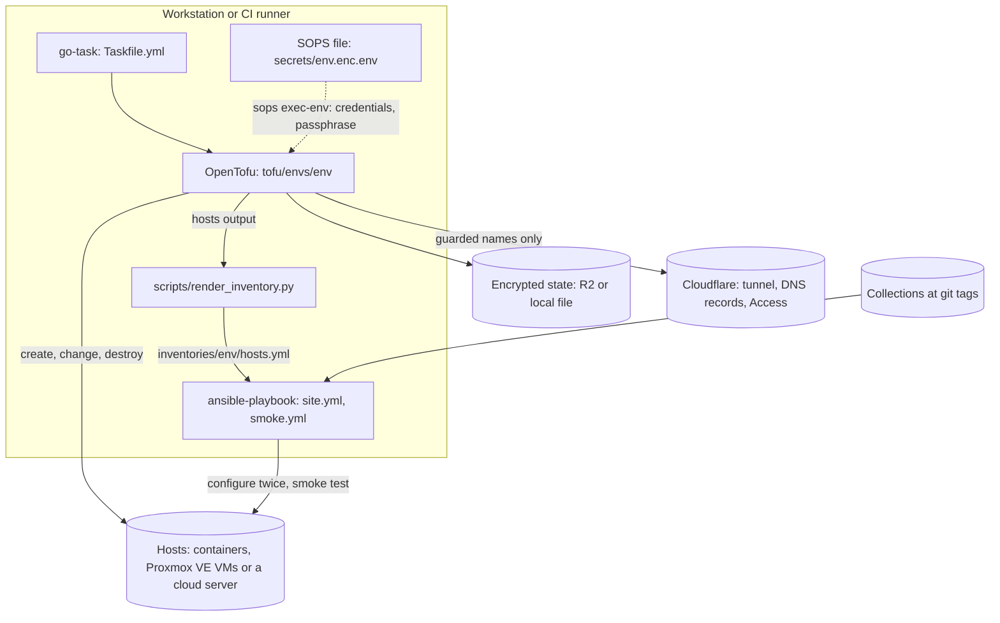

# Architecture

infra-edge-lab describes a small edge environment as code: OpenTofu creates the hosts, the tunnel,
its DNS records and the Access rules; Ansible configures the hosts; SOPS keeps the credentials;
go-task is the single entry point ([ADR 0008](adr/0008-go-task-as-the-single-entry-point.md)).
The same code builds four environments that differ in their substrate, their lifetime and their
protection, and CI rebuilds one of them from nothing on every pull request.

## Production boundary

This repository never manages an existing production server, and it must not be pointed at one.

- Every environment creates its own hosts and destroys only what its own state holds; no
  inventory value, variable default or example names a host that this repository did not create.
  The inventory of an environment is generated from its OpenTofu outputs only
  ([ADR 0021](adr/0021-one-site-playbook-with-the-inventory-from-the-opentofu-outputs.md)).
- The cloud token of `demo` and `showcase` belongs to a cloud project that holds nothing but this
  lab ([secrets/env.example](../secrets/env.example)); a token of a project with other servers is
  never used here.
- In the shared DNS zone, an environment may write only names with its own prefix (`lab-*`,
  `demo-*`, `show-*` and `play`), only as tunnel CNAMEs (plus DNS-only A and AAAA records for
  `play`), each marked with the comment `managed-by-tofu env=<env>`. Validations, tests and a
  preflight against the live zone enforce this before any apply
  ([ADR 0009](adr/0009-guard-rails-for-a-shared-dns-zone.md),
  [ADR 0024](adr/0024-a-tunnel-test-guarded-by-a-zone-preflight-a-comparison-and-a-sweeper.md)).
- Monitoring checks of hosts outside the environment (`monitoring_external_probes`) are read-only
  HTTP, keyword, port or SMTP checks of a host name, at most every five minutes, with no
  credentials.

## From code to configured hosts

1. `task init` and `task plan` run OpenTofu in one environment under `tofu/envs/`. When the
   environment's SOPS file exists, the command runs under `sops exec-env`, so the credentials and
   the state passphrase exist only in that process
   ([ADR 0006](adr/0006-sops-and-age-for-secrets.md)).
2. `task up` applies the environment (after `task preflight` and `task dns-backup` for the
   environments with Cloudflare), writes the inventory from the `hosts` output, runs
   `site.yml`, then `smoke.yml`. `task rebuild` destroys first and times the whole run;
   `task e2e:local` does the same for `local`, runs the playbook twice, plans again and ends
   with the restore test of every host (`task restore-test`).
3. The state is encrypted by OpenTofu before it is written, in R2 for `lab`, `demo` and
   `showcase` and in a local file for `local`
   ([ADR 0013](adr/0013-encrypted-state-in-r2-with-a-lock-file.md)).
4. `site.yml` uses the roles of `luminare.infra_edge` and `luminare.gameserver`, installed from
   their GitHub repositories at the tags in `ansible/requirements.yml`
   ([ADR 0016](adr/0016-collections-from-git-tags-and-one-pinned-bundle.md)), the `prometheus`
   role of `prometheus.prometheus`, and the three roles in `ansible/roles`.

## Environments

| Environment | Substrate | Hosts | Lifetime | Applied by |
|---|---|---|---|---|
| `local` | systemd containers on the local Docker daemon (`docker_host`, [ADR 0010](adr/0010-systemd-containers-as-a-local-substrate.md)) | `edge-01` (`edge`, `monitoring`), `db-01` (`db`), `fx-01` (`fxserver`) | one run: `task e2e:local` destroys it at the end | every pull request (`e2e-local`), any workstation |
| `lab` | Proxmox VE virtual machines (`pve_vm`) | `edge-01`, `db-01` (protected), optionally `fx-01` | long-lived | the operator's workstation only |
| `demo` | one cloud server (`hcloud_vm`) or one container (`substrate = "docker"`) | `edge-01` (`edge`, `db`) | thrown away after use, never protected | the reviewed `apply` workflow, or the tunnel test |
| `showcase` | one cloud server with a primary IPv4 address (skeleton) | `edge-01` (`edge`, `db`, `fxserver`) | long-lived, always protected, never destroyed by a task | the reviewed `apply` workflow |

Each environment is a root module of its own, with its own state, providers, name prefix and
guard tests ([ADR 0014](adr/0014-one-root-module-per-environment.md)); the inputs and outputs
are in [tofu/envs/README.md](../tofu/envs/README.md). Every environment returns the same `hosts`
output, so the inventory and the playbook do not depend on the substrate.

## Roles on the hosts

`site.yml` assigns roles by inventory group, in this order:

| Group | Roles | Source |
|---|---|---|
| every host | base hardening: users, SSH keys only, nftables with policy drop and `/etc/nftables.d`, fail2ban, unattended upgrades, journald retention | `luminare.infra_edge.base` |
| `monitoring`, `docker_hosts` | Docker Engine with published ports on loopback | `docker` ([ADR 0019](adr/0019-docker-ports-on-loopback-and-a-firewall-that-restarts-docker.md)) |
| every host | node_exporter; Uptime Kuma and its monitor checklist where it is switched on | `monitoring` ([ADR 0017](adr/0017-node-exporter-from-the-release-archive.md), [ADR 0018](adr/0018-uptime-kuma-monitors-as-a-checklist.md)) |
| `edge` | the tunnel connector (only with a tunnel token), nginx | `luminare.infra_edge.cloudflared`, `luminare.infra_edge.nginx` |
| `db` | MariaDB with local dumps | `luminare.infra_edge.mariadb` |
| `fxserver` | the game server, its web admin panel, the upload-only deploy target; one host at a time | `luminare.gameserver.fxserver`, `luminare.gameserver.txadmin`, `deploy_target` ([ADR 0020](adr/0020-upload-only-deploy-key-and-a-path-unit.md), [ADR 0028](adr/0028-the-game-server-user-fxserver.md)) |
| `monitoring` | Prometheus with the game server observability jobs and rules | `prometheus.prometheus.prometheus`, `luminare.gameserver.gameserver_observability` |
| every host | restic backups, last, after the roles that write what it backs up | `luminare.infra_edge.restic_backup` ([ADR 0027](adr/0027-restic-for-the-backups-of-every-host.md)) |

The base role owns `/etc/nftables.conf` (input and forward policy drop, the last line includes
`/etc/nftables.d/*.nft`); every other role that needs an inbound port adds a drop-in there with
accept rules only.

## Network and access

| Service | Port | Listens on | Who reaches it |
|---|---|---|---|
| Published web hostnames (`lab-demo`, `demo-web`, `show-web`) | 8080 (nginx, the ingress target) | `127.0.0.1` on the edge host | the tunnel connector on the same host; `demo-web` only with a service token |
| Uptime Kuma (`lab-status`) | 3001 | loopback of its host | the tunnel connector, behind an Access login |
| SSH | 22 | the host | `local` and `demo`: from the host itself only (in `demo` the tunnel connector carries `demo-ssh` behind a service token, as `show-ssh` in `showcase`); otherwise the base role's default, the management networks in `base_mgmt_cidrs` |
| Game server | 30120 TCP and UDP | the game server host | players; UDP cannot pass the tunnel, so `showcase` has the DNS-only name `play`; a cloud server's firewall opens the port only on a host in `fxserver` |
| Game server admin panel | 40120 | the game server host | loopback and the sources in the txadmin role's firewall drop-in (the edge host in `local`); published only behind an Access login (`lab-tx`, `demo-tx`, `show-tx`) |
| MariaDB | 3306 | loopback, or a private address with a drop-in for the game server hosts | the game server hosts of the environment |
| node_exporter | 9100 | loopback or a private address | the Prometheus host, through a drop-in |
| Prometheus | 9090 | loopback in `local`; `site.yml` refuses a public address | the monitoring host itself |
| Tunnel connector metrics | 2000 | `127.0.0.1` | the host itself |

The tunnel connector opens outbound connections only (port 7844); no host publishes a web port
to the internet. Hostnames are first-level names under the zone (`lab-x.<zone>`), because the
edge certificate covers one level only. TLS from the connector to its origins is described in
[ADR 0026](adr/0026-tls-between-the-tunnel-connector-and-its-origins.md); the Proxmox VE API
tokens in [ADR 0025](adr/0025-proxmox-ve-api-tokens-with-least-privilege.md); the tunnel and its
token in [ADR 0011](adr/0011-remotely-managed-tunnel-and-its-token.md).

## Secrets

| Secret | Where it lives | How it is used |
|---|---|---|
| API tokens, account and zone IDs, the state passphrase | `secrets/<env>.enc.env` and `secrets/<env>-ci.enc.env` (SOPS, age) | `sops exec-env` puts them into the environment of one OpenTofu or Ansible command |
| Secret inventory values (database, backup and admin passwords) | `ansible/inventories/<env>/group_vars/*.sops.yaml` | decrypted at run time by the SOPS vars plugin of `community.sops` |
| The tunnel token | Cloudflare | fetched by `task configure` for one playbook run (`scripts/tunnel_token.py`); on the host in a 0600 file read with `--token-file` |
| Access service token secrets | the encrypted state | outputs marked sensitive |
| Throwaway secrets of `local` and `demo` | `ansible/inventories/<env>/.generated/` (git-ignored) | generated on first use, removed with the environment |

The repository ships no encrypted file and no recipients; [configuration.md](configuration.md#secrets)
shows how an operator creates the keys and the files.

## Checks and workflows

| Workflow | When | What |
|---|---|---|
| `ci` | every pull request and push to `main`; Molecule on pull requests, on demand and weekly | `lint-test` (the template's repository checks, the unit tests and ansible-lint), `secrets / gitleaks` (the full history), `tofu` (fmt, validate, TFLint, the IaC security scan of `tofu/` and `images/` with Trivy, `tofu test` with mocked providers, the `docker_host` integration test, `terraform validate`), `molecule` (each role in `ansible/roles` on Debian 13 and Ubuntu 24.04) |
| `pr-title` | pull requests | the pull request title |
| `e2e-local` | every pull request, on demand | `task e2e:local` ([ADR 0022](adr/0022-an-end-to-end-run-of-the-local-environment-on-every-pull-request.md)) |
| `plan`, `apply`, `drift`, `e2e-tunnel` | off until `CLOUD_ENVS_ENABLED` is `true` | read-only plans, reviewed applies, nightly drift, the tunnel test ([ADR 0023](adr/0023-gated-cloud-workflows-with-read-only-plans-and-reviewed-applies.md)) |
| `release`, `scorecard` | push to `main`; Scorecard also weekly | draft releases with checksums and provenance, OpenSSF Scorecard |

Every action is pinned by commit SHA, every downloaded binary by sha256 and every Python package
by hash ([ADR 0002](adr/0002-pin-actions-and-downloaded-tools.md), [toolchain.md](toolchain.md)).

## Repository layout

| Folder | Holds |
|---|---|
| `tofu/modules/` | `pve_vm` (Proxmox VE virtual machine), `hcloud_vm` (cloud server with firewall), `cf_tunnel` (tunnel, ingress rules and DNS records behind the zone guard), `cf_access_app` (Access applications and service tokens), `docker_host` (systemd containers standing in for machines); each with a README, mocked tests and a lock file |
| `tofu/envs/` | `local`, `lab`, `demo`, `showcase`: one root module each, with its own encrypted state, lock file and guard tests |
| `images/systemd-host/` | the host image of `docker_host` and of the Molecule scenarios (Debian 13 or Ubuntu 24.04, base images pinned by digest) |
| `ansible/` | `ansible.cfg`, `requirements.yml`, the playbooks (`site.yml`, `smoke.yml`, the preparation playbooks of `local` and of the tunnel test), the inventories' `group_vars`, and the roles `docker`, `monitoring` and `deploy_target`, each with a README and a Molecule scenario |
| `secrets/` | the README and `env.example`; encrypted files only |
| `scripts/` | the template's repository checks; the environment, OpenTofu, inventory, Cloudflare and end-to-end helpers that the tasks and workflows run |
| `tests/` | unit tests of the scripts and conventions, and the stand-in game server build of `local` |
| `docs/` | this page, installation, configuration, toolchain, runbook, troubleshooting, upgrade, the hand-over of `showcase`, the ADRs, and the recording of `task e2e:local` in `media/` |
